```{r setup, include=FALSE}
library(qrcode)
library(ggplot2)

# QR code for repo (using qr_code and png device)
if (! file.exists("figures/qrcode.png")) {
  qr <- qr_code("https://github.com/corybrunson/IEEE-VIS-2026")
  png("figures/qrcode.png", width = 300, height = 300)
  plot(qr)
  dev.off()
}
```

# intro

Emergent themes:

* validity & constraints v. flexibility & control
* domain-specificity of this trade-off

Think of biplots as a case study.

<!--
{width=100%}
-->

# geometric data analysis

# ordination (gradient analysis) {.small-body}

1. Data matrix $X_{n \times p} \in \mathbb{R}^{n \times p}$:

    - centered & scaled case--variable table (principal components analysis)
    - double-centered contingency table (correspondence analysis)

2. SVD into **inertia** and rotation matrices of left and right **singular vectors**:
$$X = U_{n \times k}\ D_{k \times k}\ {V_{p \times k}}^\top$$

3. Low-dimensional approximation via first $r < k$ **ordinates**:

{width=100%}

# biplots {.small-body}

**Principal coordinates** $F = UD$ and $G = VD$ approximate the geometry of the rows or columns of $X$:

* Distances between rows of $F$ approximate distances between cases of $X$
  * Lengths approximate distances from the origin
* Inner products of rows of $G$ approximate covariances of variables of $X$
  * Cosines approximate correlations

**Standard coordinates** $U$ or $V$ pair with principal coordinates to recover the values of $X$:

* Inner products of rows of $F$ and $V$, or of $U$ and $G$, approximate entries of $X$

**Biplots** superimpose row coordinates $UD^a$ and column coordinates $VD^b$ with $a + b = 1$

# recap

- shared, highly rigid statistical theory underlying many techniques
- rigid geometric representation essential for interpretation
- few devoted software tools; most obscure unifying theory

# challenges for graphical grammars

# aspect ratios (axes and panels)

::: {.columns}
::: {.column width="50%"}
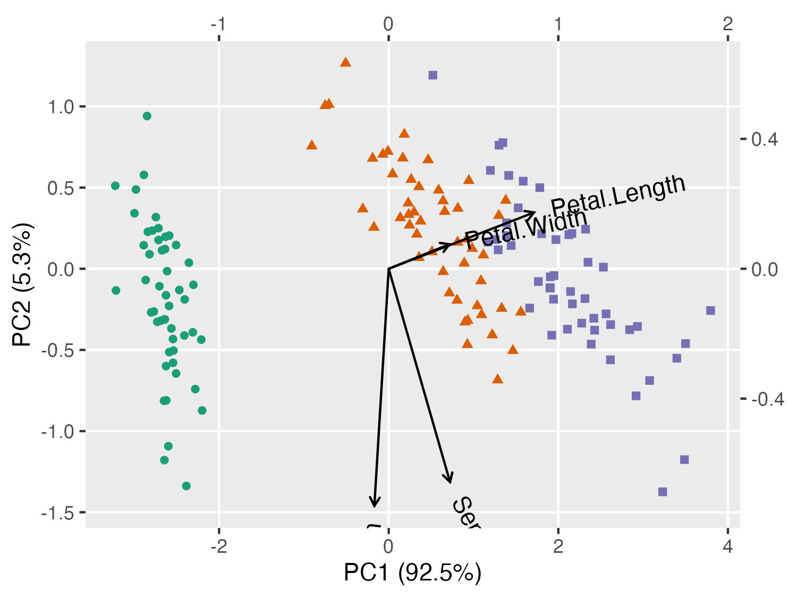{width=100%}
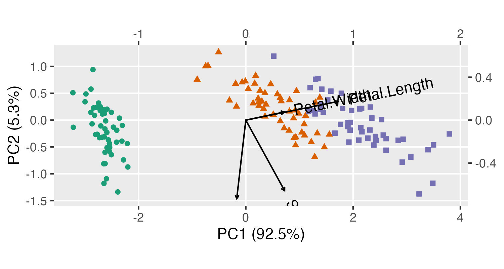{width=100%}
:::
::: {.column width="50%"}
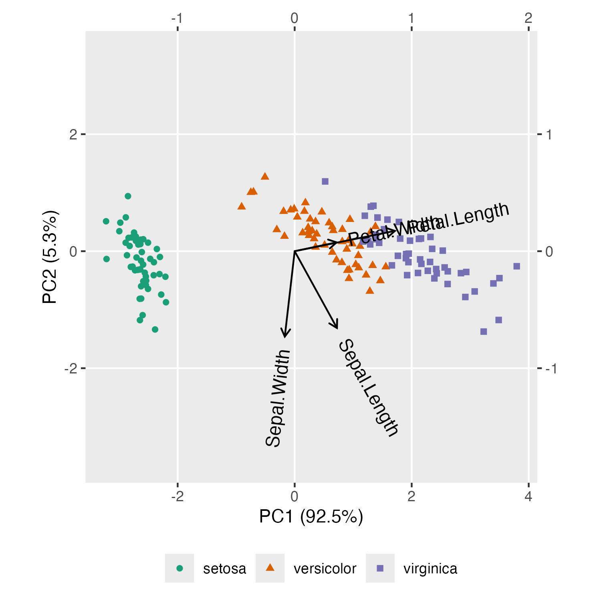{width=100%}
:::
:::

# (also relevant to glyphs)

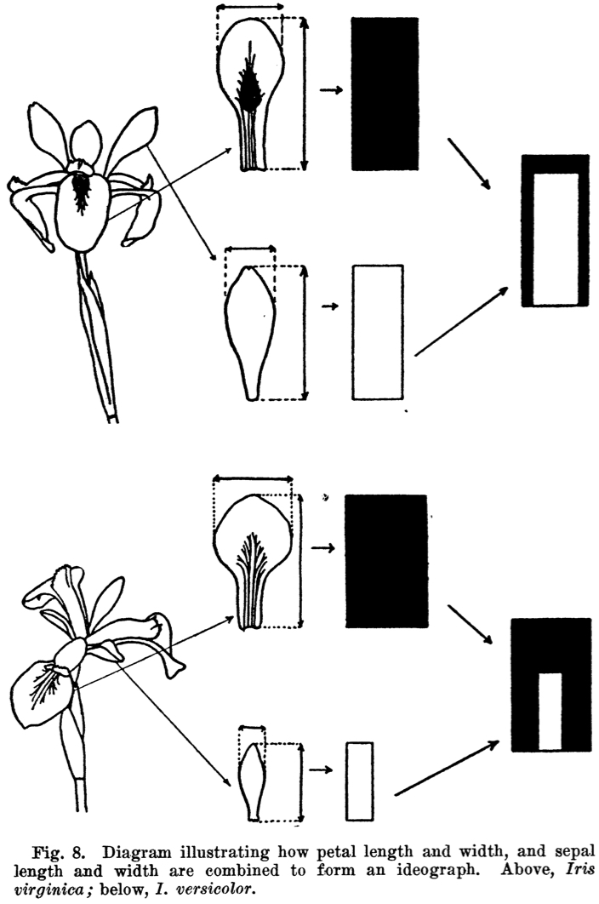{width=100%}

# axis calibration

::: {.columns}
::: {.column width="50%"}
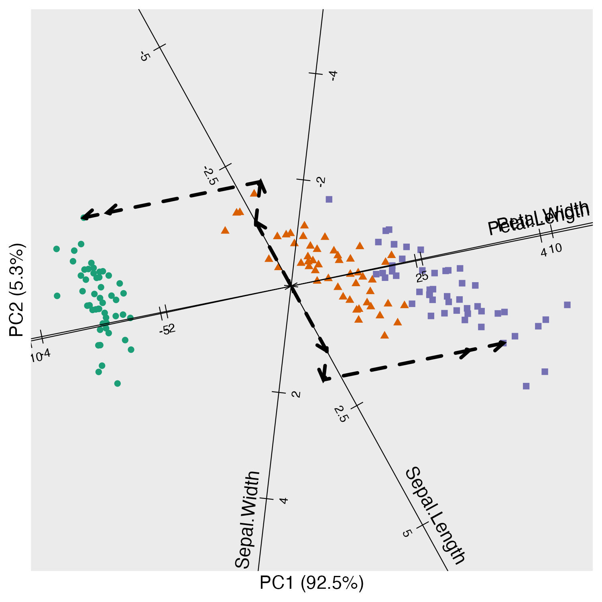{width=100%}
:::
::: {.column width="50%"}
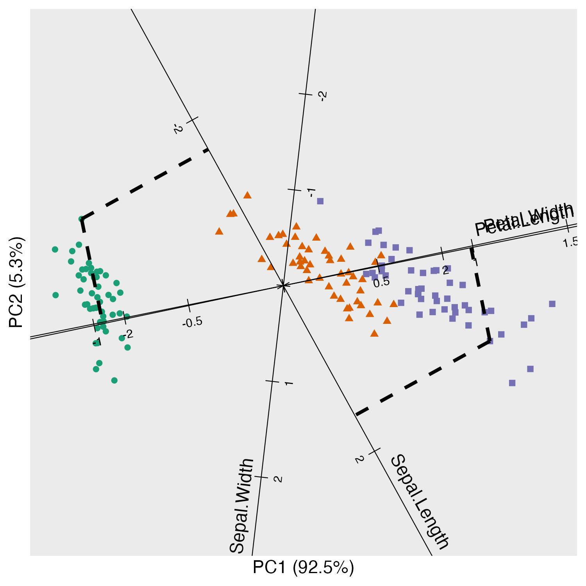{width=100%}
:::
:::

# conference of inertia

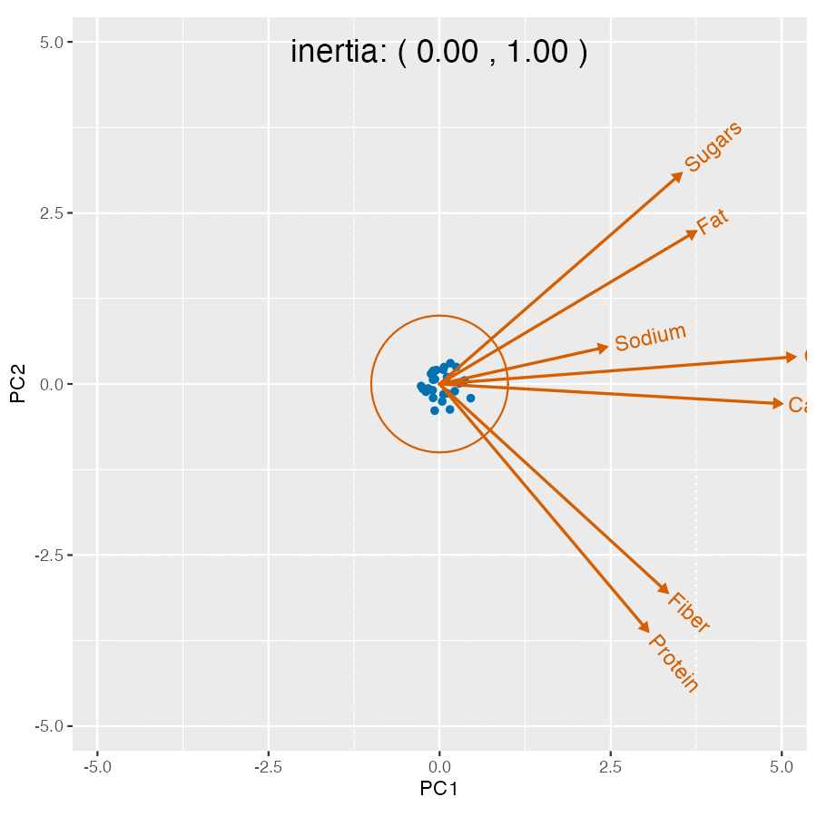{width=100%}

# referential positioning

::: {.columns}
::: {.column width="50%"}
{width=100%}
:::
::: {.column width="50%"}
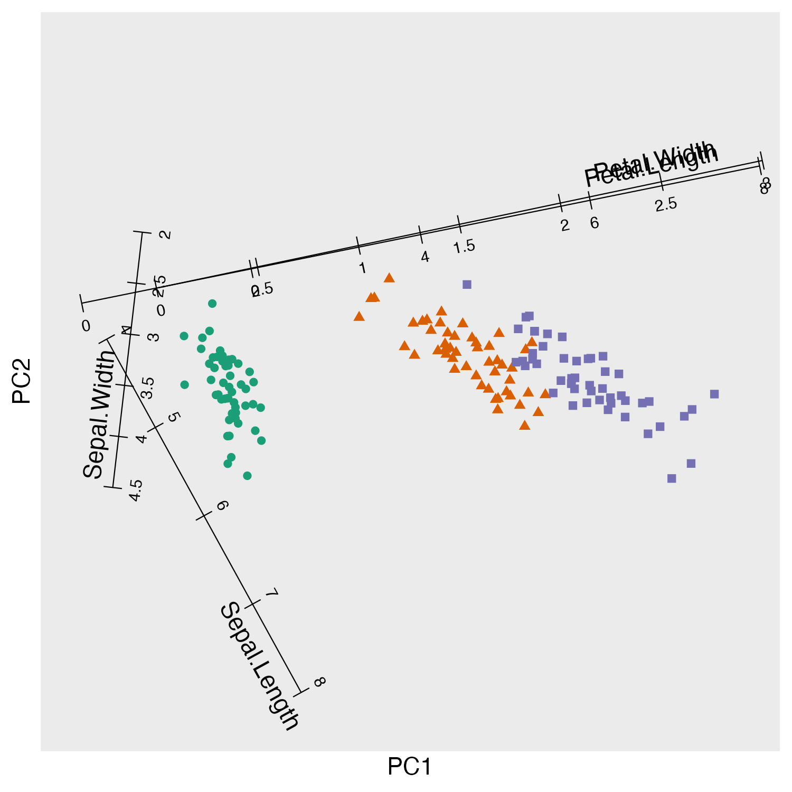{width=100%}
:::
:::

# high-dimensional geometry

::: {.columns}
::: {.column width="50%"}
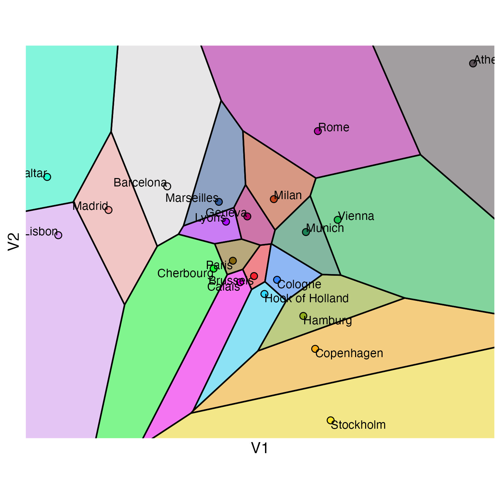{width=100%}
:::
::: {.column width="50%"}
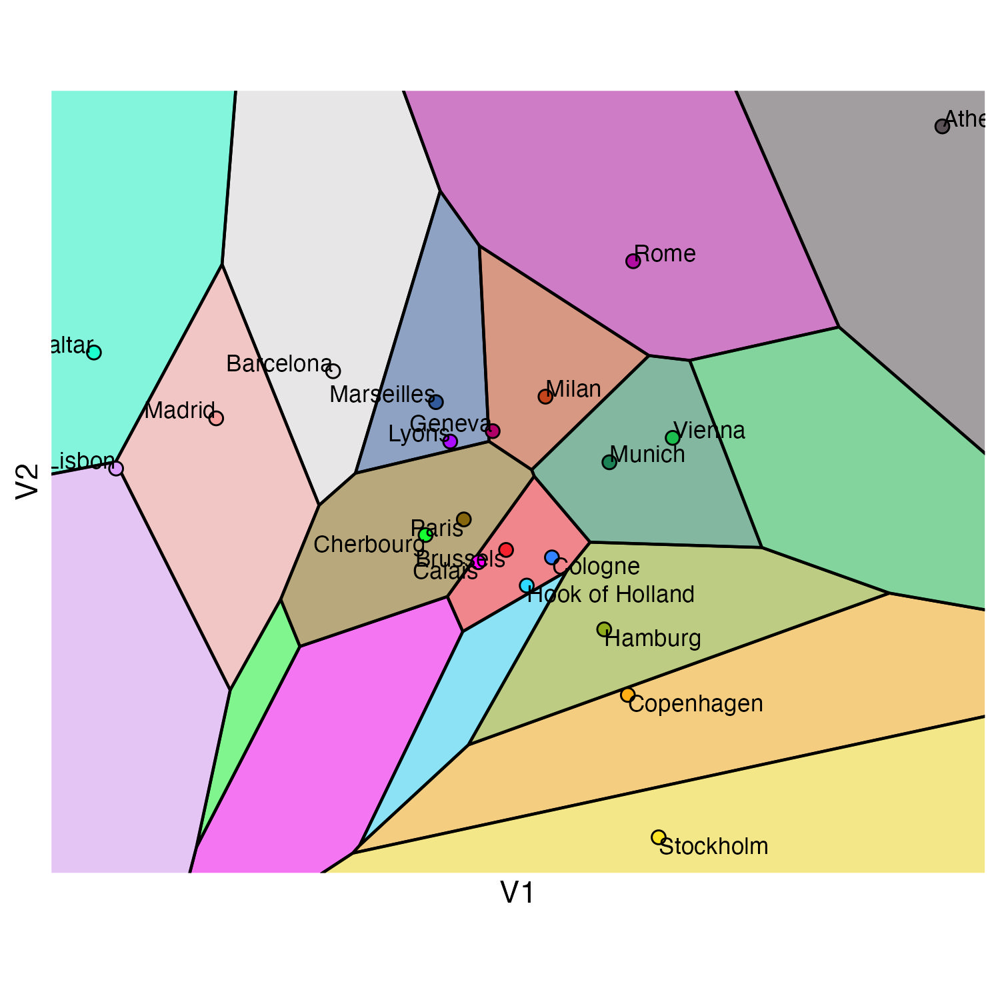{width=100%}
:::
:::

# precap {.small-body}

::: {.columns}
::: {.column width="50%"}
Ordination techniques yield high-dimensional geometric representations

* intermediate phase (bundle?) of _geometric representations_ between statistical transformations and graphical elements

Biplot specifications complicate the distinctions between steps in the GoG pipeline

* blurred boundaries between geometric elements, coordinate systems, and guides
* "breaking the fourth wall"

Cross-domain modularity requires us to systematize domain--dialect relations

* logical property--constraint table; formal concept analysis?
* heightened risk that example galleries reduce grammars to typologies

:::
::: {.column width="50%"}
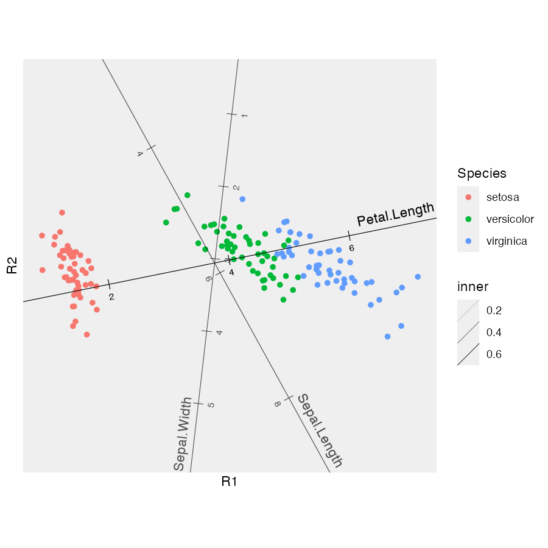{width=100%}
:::
:::

# thank you!
