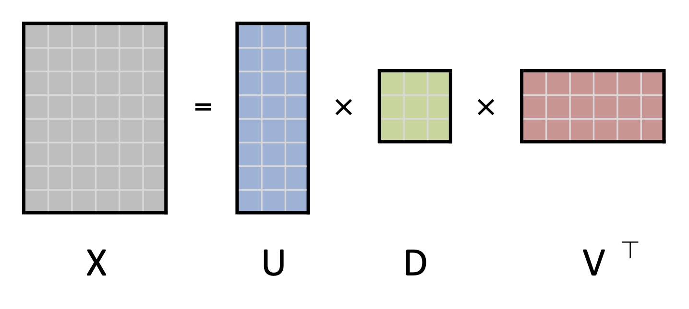
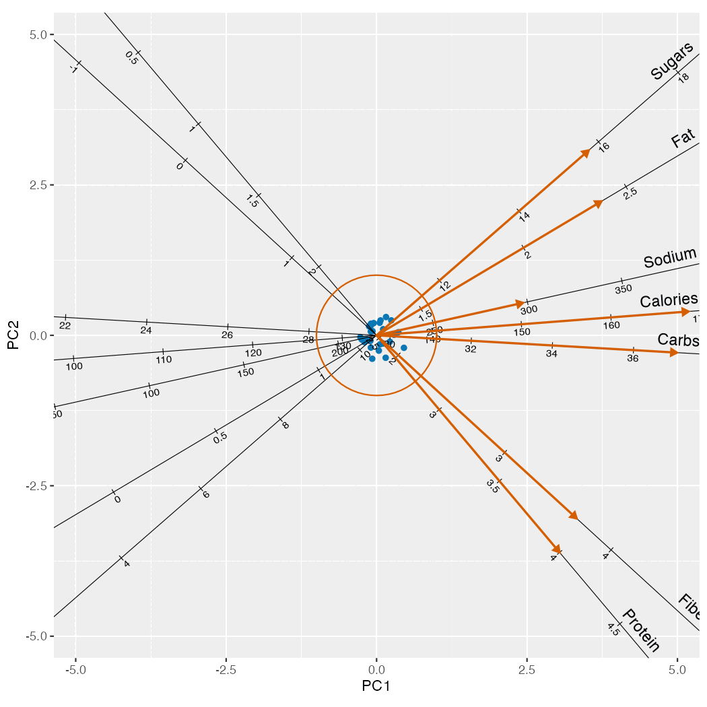

```{r setup, include=FALSE}
library(qrcode)
library(ggplot2)

# QR code for repo (using qr_code and png device)
if (! file.exists("figures/qrcode.png")) {
  qr <- qr_code("https://github.com/corybrunson/IEEE-VIS-2026")
  png("figures/qrcode.png", width = 300, height = 300)
  plot(qr)
  dev.off()
}
```

---

::: {.columns}
::: {.column width="50%"}
* thank you for welcoming me
* biplots as a case study
:::
::: {.column width="50%"}
{width=50%}
:::
:::

---

# geometric data analysis

---

# foundation {.small-body}

1. Data matrix $X_{n \times p} \in \mathbb{R}^{n \times p}$

2. SVD into **inertia** and rotation matrices of left and right **singular vectors**:
$$X = U_{n \times k}\ D_{k \times k}\ {V_{p \times k}}^\top$$

3. Low-dimensional approximation via first $r$ **ordinates**:
$$X \approx U_r\ D_r\ {V_r}^\top$$

{#fig-svd width=80%}

---

# biplots {.small-body}

**Principal coordinates** $F = UD$ or $G = VD$ approximate the geometry of the rows or columns of $X$:

* Distances $\lVert f_{j\ \bullet} - f_{i\ \bullet} \rVert$ approximate distances $\sqrt{(x_{j\ 1} - x_{i\ 1})^2 + \cdots + (x_{j\ p} - x_{i\ p})^2}$
* Inner products $\frac{1}{n}\ g_{i\ \bullet}\cdot g_{j\ \bullet}$ approximate covariances $\operatorname{cov}(x_{\bullet\ i},x_{\bullet\ j})$
  * Cosines $\cos(\arg(g_{i\ \bullet},g_{j\ \bullet}))$ approximate correlations $\operatorname{cor}(x_{\bullet\ i},x_{\bullet\ j})$

**Standard coordinates** $U$ or $V$ pair with principal coordinates to recover the values of $X$:

* Inner products $f_{i\ \bullet}\cdot v_{j\ \bullet}$ and $u_{i\ \bullet}\cdot g_{j\ \bullet}$ approximate entries $x_{ij}$

**Biplots** superimpose row and column coordinates with shares $(a,b)$ of inertia:
$$\left[\begin{array}{c} U\ D^a \\ V\ D^b \end{array}\right] \in \mathbb{R}^{(n + p) \times r}$$

---

# summary

- shared highly rigid statistical theory underlying many techniques
- geometric representation exists prior to graphical specification
- limited selection of software tools; most shield users from unifying theory

---

# implications for GoG

---

# non-proportional dependency between plot elements

::: {.columns}
::: {.column width="50%"}
proper biplots have balanced inertia: superimpose $U D^{a}$ and $V D^{b}$ with $a + b = 1$
:::
::: {.column width="50%"}
{width=100%}
:::
:::

---

# contributions to GoG

---
